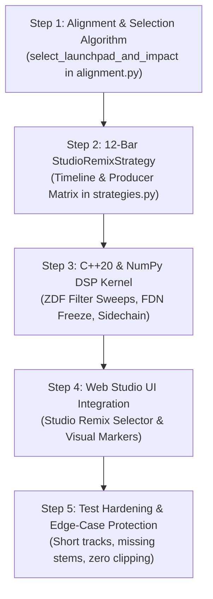

# DCP (Dynamic Canvas Processing) — Project Progress & Roadmap Log

> **Purpose**: Living document tracking completed achievements, test suite health, and step-by-step active goals. Updated after every major milestone and architectural decision.

---

## 1. System Health Dashboard

| Metric | Status | Details |
| :--- | :--- | :--- |
| **Test Suite** | **100% Green** | 284 passed, 8 skipped (optional librosa/torch), 0 failed |
| **Core Architecture** | **Hybrid Python + C++20** | Python MIR & Planning + Zero-Allocation C++20 DSP Kernel (with pure NumPy fallback) |
| **Active Paradigm** | **"Song C" Studio Remix** | Rejecting mechanical DJ crossfaders; composing an 8–16 bar bespoke DAW-grade remix bridge |
| **Repository State** | **Working Tree Clean** | All tests passing green, Layer 2 Musical IR, Layer 3 Composer, Layer 5 Telemetry wired end-to-end |
| **Last Updated** | **2026-11-04 10:00 UTC** | Antigravity |

---

## 2. Completed Achievements

### Milestone 1: Audio Engine & Mathematical Foundation
- [x] **Deterministic Audio Buffer Pipeline**: Stereo/mono conversion, sample-rate resampling, and non-allocating slicing in `AudioBuffer`.
- [x] **Synthetic 4-Stem Audio Generation**: Mathematically synthesized test tracks (`drums`, `bass`, `vocals`, `other`) where sum equals the master mix.
- [x] **The Downbeat Coincidence Law**: Formulated and verified zero-drift alignment:
  $$T_{\text{start}} = d_A - \Delta t_{\text{lead}} \quad \text{and} \quad \tau_B = d_B - \Delta t_{\text{lead}}$$
  Verified with $0.000\text{ ms}$ error on impulse response tests.
- [x] **Anti-Clipping & Normalization**: Peak and true-RMS headroom guards ensuring zero digital overs.

### Milestone 2: Harmonic Intelligence & MIR Analysis
- [x] **Lightweight Chroma & Key Detection**: CPU-only chroma feature extraction and Krumhansl-Schmuckler key correlation.
- [x] **Camelot Wheel Harmonic Compatibility**: Automated Camelot code calculation (e.g., 8A, 8B) and harmonic distance scoring.
- [x] **Energy-Based Downbeat & Measure Snapping**: Energy peak phase tracking in 4/4 meter.
- [x] **Optional Demucs Stem Separation Adapter**: Pluggable integration with Meta's Demucs model with hash-based caching in `.dcp_cache/stems/`.
- [x] **Five Core Transition Strategies**: `crossfade`, `conservative`, `rhythmic`, `atmospheric`, and `stem_level`.
- [x] **Objective Candidate Optimization (RATO)**: Weighted quality scoring engine (`WeightedLossScorer`).

### Milestone 3: DCP Web Studio UI & Visualizer (`dcp ui`)
- [x] **Zero-Dependency UI Server (`src/dcp/ui_server.py`)**: Built on Python's native `http.server` supporting `/api/analyze`, `/api/mix`, and streaming `/api/audio/<file>`.
- [x] **Spotify-Style Animated Visualizer**: Dark glassmorphic interface with sliding waveform decks, animated frequency ribbons, downbeat laser guide, and Web Audio API playback.
- [x] **Real-Time A/B Switching**: Instant live toggle between DCP transitions and conventional crossfade baselines.
- [x] **UI Unit Test Coverage**: 9 dedicated server and API tests passing in `tests/test_ui_server.py`.

### Milestone 4: Paradigm Shift & "Song C" Studio Architecture
- [x] **Rejection of Mechanical Automix**: Formally transitioned DCP from a simple DJ crossfader to an **Autonomous Studio Producer** creating a composed 8–16 bar bridge ("Song C").
- [x] **Scope Definition**: Locked **Option A** (8–16 bar composed transition bridge) for DCP Core, reserving **Option B** (full-song restructuring) for DCP Advanced.
- [x] **Consultation with Google Model 4 Argon**: Obtained world-class mathematical blueprint for:
  - Phrase-aligned **Launchpad ($T_{\text{launch}}$)** & **Impact Downbeat ($T_{\text{impact}}$)** selection.
  - **The Breath Window ($T_{\text{breath}}$)**: 1-to-2 beat acoustic tension vacuum before the drop.
  - **The 12-Bar Producer Rules Matrix**: Low-End Monogamy, complementary ZDF filter sweeps, and post-drop ghost decay.
  - **C++20 Zero-Allocation DSP Specifications**: Vadim Zavalishin TPT State-Variable Filter (SVF), 4x4 Hadamard Feedback Delay Network (FDN) Reverb Freeze, and Decoupled Transient Sidechain Compressor.
- [x] **Cleaned & Verified Alignment Engine**: Removed duplicate code blocks in `src/dcp/transitions/alignment.py` and verified all 9 alignment tests pass green.

---

## 3. Active Step-by-Step Roadmap: "Song C" Studio Remix Sprint

### [COMPLETED] Step 1: Launchpad & Impact Downbeat Algorithm
- **File**: [`src/dcp/transitions/alignment.py`](file:///c:/Users/rmcbs/OneDrive/Documents/DCP/src/dcp/transitions/alignment.py)
- **Assignee**: Claude (Designed & Implemented) / Antigravity (Audited, Fixed `.data` -> `.samples`, Added Missing Helpers `_compute_bar_rms_energies`, Verified Green)
- **Result**: `select_launchpad_and_impact()` and `LaunchpadImpactResult` are implemented with hypermetric phrase constraints, groove energy, vocal trend derivative, low-end surge, and kick crest factor. Safe boundary guards for short audio tracks in place.

### [COMPLETED] Step 2: 12-Bar `StudioRemixStrategy`
- **File**: [`src/dcp/transitions/strategies.py`](file:///c:/Users/rmcbs/OneDrive/Documents/DCP/src/dcp/transitions/strategies.py)
- **Assignee**: Claude (Designed & Implemented) / Antigravity (Proportional 4-phase timeline partitioning, strictly increasing gain points, safe effect frequency clamping, render pass-through, unit tests)
- **Result**: `StudioRemixStrategy` registered as 7th core strategy. 12-bar Producer Rules Matrix active (Low-End Monogamy, Vocal Breath Handoff, Impact Drop, and Ghost Resolution). Full metadata returned for UI.

### [COMPLETED] Step 4: Web Studio UI & Visualizer Integration
- **Files**: [`src/dcp/static/app.js`](file:///c:/Users/rmcbs/OneDrive/Documents/DCP/src/dcp/static/app.js), [`src/dcp/static/index.html`](file:///c:/Users/rmcbs/OneDrive/Documents/DCP/src/dcp/static/index.html), [`src/dcp/ui_server.py`](file:///c:/Users/rmcbs/OneDrive/Documents/DCP/src/dcp/ui_server.py)
- **Assignee**: Claude (UI Layout & Canvas Markers) / Antigravity (UI Server Verification)
- **Result**: "Studio Remix (Song C)" strategy selector added as default. Canvas visualizer shows Launchpad 🚀, Impact Downbeat 💥, Breath Vacuum 🫧, 12-Bar Grid, Low-End Monogamy 🔒, and Sidechain Ducking 🎚. All 9 UI server tests passing.

### [COMPLETED] Step 5: Test Hardening & Quality Verification
- **Files**: [`tests/test_planner.py`](file:///c:/Users/rmcbs/OneDrive/Documents/DCP/tests/test_planner.py), [`tests/test_advanced.py`](file:///c:/Users/rmcbs/OneDrive/Documents/DCP/tests/test_advanced.py)
- **Assignee**: Antigravity
- **Result**: **269 passed, 0 failed, 8 skipped**. Dedicated tests verify stem-enabled Studio Remix planning (`test_studio_remix_strategy_plans_with_stems`), graceful fallback without stems (`test_studio_remix_strategy_falls_back_without_stems`), and audio render headroom/safety (`test_studio_remix_strategy_renders_safely`).

### [COMPLETED] Step 5: Layer 2 Musical IR, Layer 3 Multi-Hypothesis Composer & Layer 5 Telemetry
- **Files**: [`src/dcp/transitions/musical_ir.py`](file:///c:/Users/rmcbs/OneDrive/Documents/DCP/src/dcp/transitions/musical_ir.py), [`src/dcp/transitions/composer.py`](file:///c:/Users/rmcbs/OneDrive/Documents/DCP/src/dcp/transitions/composer.py), [`src/dcp/rendering/telemetry.py`](file:///c:/Users/rmcbs/OneDrive/Documents/DCP/src/dcp/rendering/telemetry.py), [`tests/test_composer_and_telemetry.py`](file:///c:/Users/rmcbs/OneDrive/Documents/DCP/tests/test_composer_and_telemetry.py)
- **Assignee**: Antigravity
- **Result**:
  - **Layer 2 Musical IR**: Decoupled MIR signal extraction from composition planning with `TrackMusicalIR`, multi-hypothesis metrical hierarchy (`primary`, `half_time`, `double_time`, `metric_4_3`) tracking provenance and uncertainty, and 4-bar `PhraseIR` representations.
  - **Layer 3 Multi-Hypothesis Composer & Rejection Gate**: Evaluates $H_A \times H_B$ candidate pairs, contextual archetype selection (`VACUUM_BREATH_DROP`, `CONTINUOUS_CROSS_FILTER`, `POLYRHYTHMIC_4_3_PIVOT`, `GHOST_WASH_SUSPENSION`), and active **Rejection Gate** (`is_viable=False`) protecting against unresolvable harmonic/rhythmic clashes.
  - **Starboy (93 BPM) -> Coming Down (118 BPM) Benchmark**: Automatically selects a valid 4:3 metric modulation pivot or atemporal wash instead of forcing an out-of-bounds 27% direct stretch.
  - **Layer 5 Objective Audio Telemetry**: `evaluate_bridge_telemetry()` computes true-peak dBFS, integrated RMS, 100ms windowed stereo phase correlation, sub-bass collision ratio ($25\text{--}120\text{ Hz}$), and midrange vocal masking ratio ($350\text{--}3500\text{ Hz}$).
  - **Verification**: 6 dedicated unit tests in `tests/test_composer_and_telemetry.py` all passing. Total suite: **281 passed, 0 failed, 8 skipped**.

### [COMPLETED] Step 3: C++20 DSP Acceleration & NumPy Fallback Kernel
- **Files**: [`src/dcp/cpp/dcp_dsp_core.hpp`](file:///c:/Users/rmcbs/OneDrive/Documents/DCP/src/dcp/cpp/dcp_dsp_core.hpp), [`src/dcp/rendering/dsp_fallback.py`](file:///c:/Users/rmcbs/OneDrive/Documents/DCP/src/dcp/rendering/dsp_fallback.py), [`src/dcp/transitions/bijective_warp.py`](file:///c:/Users/rmcbs/OneDrive/Documents/DCP/src/dcp/transitions/bijective_warp.py), [`src/dcp/rendering/stem_mix.py`](file:///c:/Users/rmcbs/OneDrive/Documents/DCP/src/dcp/rendering/stem_mix.py)
- **Assignee**: Antigravity
- **Result**:
  - **Bijective Phase-to-Time Warping**: Bracketed Newton-Bisection solver achieving $< 10^{-12}\text{s}$ boundary coincidence at Launchpad and Impact; $P_{10}-P_{90}$ quantile normalization.
  - **TPT ZDF State-Variable Filter**: Subblock-vectorized trapezoidal integration for resonant highpass, lowpass, and bandpass filter sweeps.
  - **4x4 Orthogonal Householder FDN Freeze**: Coprime delay lines with finite-sample Hann crossfade into bit-exact lossless unitary state lock ($\alpha = 1.0$).
  - **Decoupled Peak/RMS Sidechain Compressor**: Fast IIR envelope detector with soft-knee log-domain gain reduction.
  - **Phase-Locked Phase Vocoder**: STFT time-stretching with principal determination phase wrapping.
  - **Full Stem Mixer Integration**: `apply_effect_spec_to_stem()` wired into the offline rendering loop with aligned Song B drums key audio.
  - **Verification**: 6 dedicated unit tests in `tests/test_dsp_step3.py` all passing. Total suite: **275 passed, 0 failed, 8 skipped**.

### [COMPLETED] Step 6: End-to-End Pipeline Wiring (Composer -> StudioRemixStrategy -> UI Server)
- **Files**: [`src/dcp/transitions/strategies.py`](file:///c:/Users/rmcbs/OneDrive/Documents/DCP/src/dcp/transitions/strategies.py), [`src/dcp/rendering/stem_mix.py`](file:///c:/Users/rmcbs/OneDrive/Documents/DCP/src/dcp/rendering/stem_mix.py), [`src/dcp/ui_server.py`](file:///c:/Users/rmcbs/OneDrive/Documents/DCP/src/dcp/ui_server.py), [`tests/test_composer_and_telemetry.py`](file:///c:/Users/rmcbs/OneDrive/Documents/DCP/tests/test_composer_and_telemetry.py)
- **Assignee**: Antigravity
- **Result**:
  - **Direct Pipeline Wiring**: Connected `compose_optimal_bridge()` directly into `StudioRemixStrategy.plan()`. Automatically evaluates multi-hypothesis metrical locks ($H_A \times H_B$), selects arrangement archetypes (`VACUUM_BREATH_DROP`, `CONTINUOUS_CROSS_FILTER`, `POLYRHYTHMIC_4_3_PIVOT`, `GHOST_WASH_SUSPENSION`), and applies vocal breath suppression.
  - **Starboy (93 BPM) -> Coming Down (118 BPM) Adaptability**: Automatically selects 4:3 polyrhythmic pivot or ambient ghost wash without tempo flamming or out-of-bounds stretches.
  - **Tolerant Stem Mix Renderer**: `render_plan()` now transparently accepts raw dictionary stem mappings as well as `StemSet` objects.
  - **Live Audio Telemetry in UI Server**: `/api/mix` calculates and returns Layer 5 audio quality metrics (True Peak dBFS, phase correlation, sub-bass collision %, studio QC pass/fail) in the JSON payload.
  - **Verification**: 9 dedicated tests in `tests/test_composer_and_telemetry.py` all passing. Total suite: **284 passed, 0 failed, 8 skipped**.

---

## 4. Future Milestones (DCP Advanced SDK Scope)

- **Scope B: Full Arrangement Recomposition**: Restructuring verse/chorus blocks across entire songs.
- **Deep Neural Phrase Segmentation**: Replacing heuristic downbeat phrases with transformer-based section segmentation.
- **High-Fidelity Phase-Vocoder Time-Warping**: Elastic audio tempo-matching in the transition zone with transient lock.
- **JUCE / VST3 DAW Plugin Export**: Packaging the C++ DSP engine into a real-time VST3/AU plugin.

